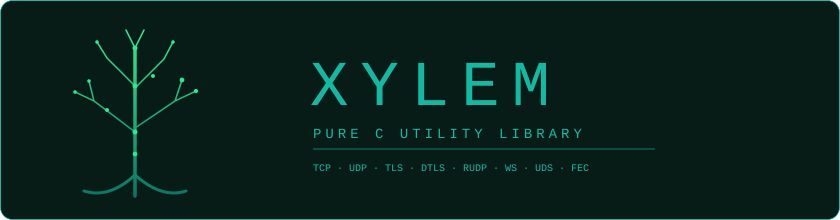

[](https://github.com/MeristemForge/Xylem/actions/workflows/cmake-multi-platform.yml)
[](https://github.com/MeristemForge/Xylem/actions/workflows/codeql.yml)
[](https://www.codefactor.io/repository/github/meristemforge/xylem)
[](https://opensource.org/licenses/MIT)
[](https://en.wikipedia.org/wiki/C11_(C_standard_revision))

# Overview
Xylem is a general-purpose C library providing concurrency, networking,
and foundational utilities.


# Features

- **Coroutines** — First-class citizens by design
- **Platforms** — Windows, Linux, macOS, Android, and iOS
- **Simplicity** — Concurrent code reads like ordinary blocking code
- **Transports** — TCP, UDP, UDS, TLS, DTLS, and RUDP
- **WebSocket** — ws/wss clients and standalone servers
- **Buffered I/O** — Reader/Writer helpers for TCP, TLS, UDS, and RUDP streams
- **Dependencies** — No required external dependencies; OpenSSL optional for TLS/DTLS/WSS


# Build

```bash
cmake -B out
cmake --build out
```

See [docs/build.md](docs/build.md) for detailed instructions on generators, sanitizers, and coverage.


# Documentation

- [Architecture](docs/architecture.md) — Layers, dependencies, and source layout
- [Build and test](docs/build.md) — Configuration, testing, sanitizers, and coverage
- [Module design](docs/design/) — Runtime, networking, synchronization, and utilities


# License
```
Copyright (c) 2026–2036, Jin.Wu <wujin.developer@gmail.com>

Permission is hereby granted, free of charge, to any person obtaining a copy
of this software and associated documentation files (the "Software"), to
deal in the Software without restriction, including without limitation the
rights to use, copy, modify, merge, publish, distribute, sublicense, and/or
sell copies of the Software, and to permit persons to whom the Software is
furnished to do so, subject to the following conditions:

The above copyright notice and this permission notice shall be included in
all copies or substantial portions of the Software.

THE SOFTWARE IS PROVIDED "AS IS", WITHOUT WARRANTY OF ANY KIND, EXPRESS OR
IMPLIED, INCLUDING BUT NOT LIMITED TO THE WARRANTIES OF MERCHANTABILITY,
FITNESS FOR A PARTICULAR PURPOSE AND NONINFRINGEMENT. IN NO EVENT SHALL THE
AUTHORS OR COPYRIGHT HOLDERS BE LIABLE FOR ANY CLAIM, DAMAGES OR OTHER
LIABILITY, WHETHER IN AN ACTION OF CONTRACT, TORT OR OTHERWISE, ARISING
FROM, OUT OF OR IN CONNECTION WITH THE SOFTWARE OR THE USE OR OTHER DEALINGS
IN THE SOFTWARE.
```
